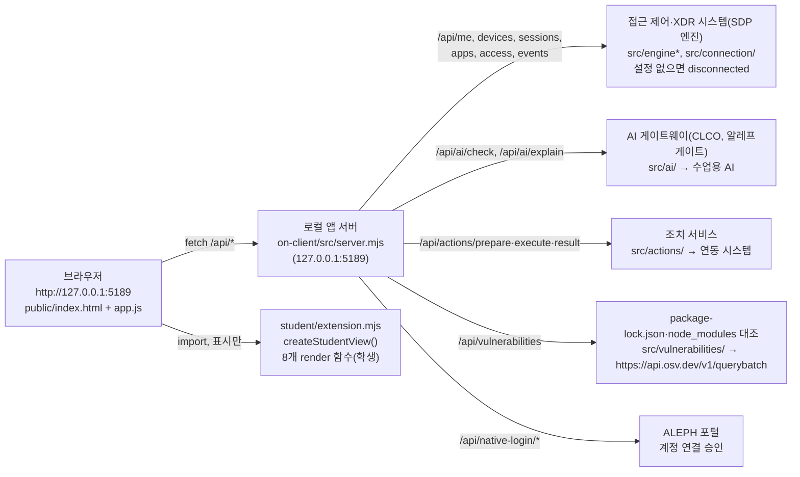

# Halo 보안 Agent · 학생 실행 설명서와 시스템 구성도

이 문서는 학생(유은수)이 작성한 문서입니다. 시작 틀이 준 문서(`README.md`, `docs/STUDENT_LAUNCH_GUIDE.md` 등)는 바꾸지 않았고, 이 파일만 새로 추가했습니다.
다른 사람이 같은 저장소를 받아 **Halo**(케셰브 시작 틀 0.2.21 기반 보안 Agent)를 켜고, 무엇이 학생 코드이고 무엇이 제공 코드인지, 어디까지 확인했는지 알 수 있게 쓰는 것이 목적입니다.

- 저장소: `https://github.com/eunsu7997/choi-bujang-secret-vault` (공개)
- 앱 폴더: 저장소 최상위의 `on-client/` — 1~12단계(BYTE BACK 메모 자료실, Vercel·Supabase) 프로젝트에 13단계부터 추가한 폴더입니다.
- Git 최상위: `on-client`가 아니라 그 위 저장소 폴더(`choi-bujang-secret-vault`)입니다. 커밋·푸시·제출은 저장소 폴더 기준입니다.
- 비밀값: 이 문서와 저장소에는 열쇠·토큰·비밀번호를 적지 않습니다. `.env`는 Git에서 빠지며, `on-client/.env.example`에는 비밀 없는 설정 이름만 있습니다.

## 1. 목적과 기능

직원(학생) 본인의 로그인 상태, 업무 앱 접근 판정, 최근 보안 기록, AI 설명, 조치 상태, 설치 패키지 취약점 조회 결과를 **사실과 해석·성공과 실패·미확인을 구분해** 보여 주는 PC용 보안 Agent 화면입니다. 화면 틀과 서버는 시작 틀이 제공하고, 학생은 `on-client/student/extension.mjs`의 표시 함수 8개를 구현했습니다.

## 2. 지원 환경과 버전

| 항목 | 기준 | 실제로 확인한 값 | 비고 |
|---|---|---|---|
| 운영체제 | Windows (PowerShell) | Windows PC에서 실행 확인 | macOS·Linux 실행은 확인하지 않음(미확인) |
| Node.js | 22~24, 수업 기준 24.19.0 (`on-client/package.json`의 `engines.node`) | 학생 PC: v24.20.0 (실행 도구가 "참고: 지금 Node.js 는 v24.20.0 입니다. 수업 기준은 v24.19.0 입니다." 안내 후 정상 실행) | 외부 npm 의존성 없음(`on-client`에 dependencies 없음) |
| Git | 저장소 커밋·푸시용 | 설치되어 사용 중 | 버전은 PC마다 다름 |
| 브라우저 | PC 브라우저 | Chrome 계열에서 `http://127.0.0.1:5189/` 접속 확인 | 1280px 이상 화면 권장 |
| 시작 틀 | 0.2.21 (`on-client/package.json`의 `version`, `.on-starter-manifest.json`) | 공식 ZIP과 파일 동일함을 커밋 `726c97a`에서 대조 | |

## 3. 폴더 구조 (실제 경로)

```text
choi-bujang-secret-vault/            ← Git 최상위(1~12단계 BYTE BACK 앱 + 13단계부터 on-client)
├─ api/ public/ src/ supabase/ ...   ← 1~12단계 메모 자료실(Vercel) — Halo 실행과 무관
└─ on-client/                         ← Halo 앱 폴더(시작 틀 0.2.21)
   ├─ package.json                    ← scripts: start / demo / check, engines.node 24.19.0
   ├─ .env.example                    ← 비밀 없는 설정 이름(ON_PORT 등)만
   ├─ tools/start-alekov.ps1          ← 실행 도구(Node 버전·폴더·포트 확인 후 src/server.mjs 실행)
   ├─ src/server.mjs                  ← 로컬 앱 서버(127.0.0.1:5189), /api/* 제공
   ├─ src/engine*, src/connection/    ← 접근 제어(SDP)·계정 연결 어댑터
   ├─ src/ai/                         ← AI 게이트웨이(CLCO) 연결
   ├─ src/actions/                    ← 조치 준비·집행·결과 조회
   ├─ src/vulnerabilities/            ← package-lock.json 대조, OSV 조회
   ├─ public/index.html, public/app.js← 제공 화면(메뉴·버튼·요청·검증)
   ├─ student/extension.mjs           ← ★ 학생 작성: 8개 표시 함수
   └─ docs/STUDENT_RUNBOOK.md         ← ★ 학생 작성: 이 문서
```

## 4. 실행·종료·재실행 (PowerShell)

### 4-1. 처음 받기 (다른 PC에서)

저장소를 받을 폴더(예: `문서`)에서 PowerShell을 열고:

```powershell
git clone https://github.com/eunsu7997/choi-bujang-secret-vault.git
```

이미 받아 둔 PC라면 저장소 폴더에서 `git pull`로 최신을 받습니다. (학생은 집 PC와 학원 PC를 번갈아 쓰므로 항상 GitHub 기준으로 이어서 작업합니다.)

### 4-2. 켜기

1. 파일 탐색기에서 `choi-bujang-secret-vault\on-client` 폴더를 엽니다.
2. 주소 표시줄을 한 번 눌러 `powershell`을 입력하고 Enter → 이 폴더에서 PowerShell이 열립니다.
3. 실행:

```powershell
powershell -NoProfile -ExecutionPolicy Bypass -File .\tools\start-alekov.ps1
```

4. **정상 시작 신호** (학생 PC에서 실제로 본 문구):
   - `계정 연결 준비가 끝났습니다. 앱에서 확인 번호로 로그인·승인을 진행하세요.`
   - `케셰브 연결 확인: http://127.0.0.1:5189`
   - `케셰브가 켜졌습니다. 브라우저에서 http://127.0.0.1:5189/ 을 여세요.`
   - `서버가 응답한 것만 확인했습니다. AI 연결 상태는 화면에서 따로 확인해 주세요.`
5. 브라우저에서 `http://127.0.0.1:5189/` → 위쪽 상태 표시와 「보호 현황」 화면이 보이면 정상입니다.

`npm start`(= `node src/server.mjs`)도 같은 서버를 켜지만 Node 버전·포트 사전 확인을 하지 않습니다. `npm run demo`는 예제 자료이며 실제 연결이 아닙니다. `npm run check`는 `student/extension.mjs` 문법만 확인합니다.

### 4-3. 종료와 재실행

- 종료: 실행한 PowerShell 창에서 `Ctrl+C`. 브라우저 주소가 더 이상 열리지 않으면 종료된 것입니다.
- 재실행: 같은 `on-client` 폴더에서 4-2의 명령을 다시 실행합니다. 실행·종료는 학생 파일을 바꾸지 않습니다.
- 실행 도구 옵션(제공 문서 `docs/CONNECTION_TROUBLESHOOT.md` 3장 기준): `-Port 5190`(포트 충돌), `-Background`, `-Demo`, `-NoNativeHost`, `-WaitSeconds 30`. `-Port 5190`은 22단계 재현에서 5189가 사용 중일 때 실제로 써서 확인했고([RELEASE_RECORD.md](RELEASE_RECORD.md) 3장), 나머지는 실행해 보지 않았습니다(미확인).

### 4-4. 화면 확인 순서

1. 「보호 현황」 → 계정 연결 확인 「시작」 → 확인 번호를 ALEPH에서 같은 계정으로 승인 → 「연결 확인」
2. AI 연결 칸 「AI 연결 시작」 → 「승인 페이지 열기」 → 승인 → 「승인했으며 연결 확인」 → 「현재 API 연결 점검」
3. 「업무 앱」에서 앱을 골라 접근 요청 → 학생 칸 renderDecision 확인
4. 「보안 기록」에서 필터·상세·AI 설명 요청 → renderEvents / renderExplanation 확인
5. 「설치 패키지 조회」 → 학생 칸 renderVulnerabilities 확인
6. 「도움정보 불러오기」 → 학생 칸 「도움정보 복사」로 여섯 값만 복사되는지 확인

## 5. 시스템 구성도

### 5-1. Mermaid



### 5-2. 같은 내용의 글 설명

| 출발 | 도착 | 경로·파일 | 무엇이 오가는가 |
|---|---|---|---|
| 브라우저 | 로컬 앱 서버 | `public/app.js` → `src/server.mjs` (`http://127.0.0.1:5189/api/*`) | 화면의 모든 자료 요청. 브라우저는 외부 시스템에 직접 붙지 않음 |
| 제공 화면 | 학생 코드 | `public/app.js`가 `student/extension.mjs`의 `createStudentView()`를 불러 각 `render*` 호출 | 이미 검증된 입력 사본만 전달. 학생 코드는 요청을 보내지 않고 DOM만 돌려줌 |
| 로컬 앱 서버 | 접근 제어·XDR 시스템(SDP) | `src/engine.mjs`, `src/engine/*`, `src/connection/*` | 본인·기기·세션, 업무 앱 목록, 접근 판정(`/api/access`), 보안 기록(`/api/events`). 설정이 없으면 `disconnected` |
| 로컬 앱 서버 | AI 게이트웨이(CLCO) | `src/ai/*` | 연결 점검(`/api/ai/check`), 사건 설명(`/api/ai/explain`). 앱 승인·운영자 권한이 있어야 동작 |
| 로컬 앱 서버 | 조치 서비스 | `src/actions/*` | 조치 준비·집행·결과 재조회. 현재 실제 기록의 supportedActions가 비어 있어 경로가 열리지 않음 |
| 로컬 앱 서버 | OSV | `src/vulnerabilities/*` → `https://api.osv.dev/v1/querybatch` | 허용된 공개 패키지만 정확한 버전으로 조회 |
| 로컬 앱 서버 | ALEPH 포털 | `/api/native-login/*`, `src/connection/native-login.mjs` | 계정 연결 확인 번호 승인 |

```text
[브라우저 127.0.0.1:5189] ──/api/*──▶ [로컬 앱 서버 src/server.mjs]
        │                                   ├──▶ [접근 제어·XDR(SDP) src/engine*]
        └─ student/extension.mjs(표시만)     ├──▶ [AI 게이트웨이(CLCO) src/ai]
                                            ├──▶ [조치 서비스 src/actions]
                                            ├──▶ [OSV api.osv.dev src/vulnerabilities]
                                            └──▶ [ALEPH 포털 계정 연결]
```

## 6. 제공 부분과 학생 작성 부분

| 구분 | 파일·함수 | 내용 |
|---|---|---|
| 제공(수정 안 함) | `public/app.js`, `public/index.html`, `src/**`, `tools/**`, `README.md`, `docs/*`(이 문서 제외) | 메뉴·버튼·요청·응답 검증·서버·연결·실행 도구 |
| 학생 13단계 | `renderIdentity` | 사용자·기기·세션의 loading/ok/error, 기기·세션 상태 한국어+원래 값, 오류 시 이전 사용자 제거, 모드 안내 |
| 학생 14단계 | `renderDecision` | idle/loading/ok/error, allow·deny·challenge·unknown, reason·checkedAt, 다른 앱 응답·모르는 값은 확인 불가, 요청 실패≠거부 |
| 학생 15단계 | `renderEvents` | at 최신순(원본 불변), 「기록 종류」「업무 앱」「접속 상태」 필터, 「<id> 상세」, 빈 목록/실패/CONTRACT_MISMATCH 구분 |
| 학생 16단계 | `renderStatus`, `renderEvents` 상세 | 기기·세션·도움정보의 로딩/빈/실패, 알림 목록, 「도움정보 복사」(여섯 값만), 「<action> 미지원」 비활성 버튼 |
| 학생 17단계 | `renderAiConnection` | 점검 전/중/test·verified/오류 8분류, "사건 설명은 아직 실행하지 않았습니다", 자동 재점검 없음 |
| 학생 18단계 | `renderExplanation` | 근거 ID 대조, 규칙, 확인 불가 상태, 제안(미실행), 근거 불일치·executed:true 거절, 성공 표식은 성공에만 |
| 학생 19단계 | `renderAction` | idle~expired 상태별 문장, ACK≠효과, effectApplied:true일 때만 효과 확인, 영수증 불일치는 결과 불명 |
| 학생 20단계 | `renderVulnerabilities` | complete~unverifiable, lockfileHash, 정확한 버전(범위값 거절), 취약점 id·modified, 부분 결과 보존 |

모든 학생 함수는 `document.createElement`와 `textContent`만 쓰고(`innerHTML` 없음), 호출마다 새 DOM 하나를 돌려줘 다시 불러오면 이전 표시가 남지 않습니다. 학생 코드에는 `fetch`·POST·열쇠가 없습니다.

## 7. 확인한 것과 확인하지 않은 것

| 항목 | 상태 | 근거 |
|---|---|---|
| 실행 도구로 앱 켜기·정상 시작 신호 | 확인 | 학생 PC(Windows, Node v24.20.0)에서 4-2의 문구 확인 |
| 13~20단계 학생 함수의 상태별 문구 | 모의 데이터로 확인 | 단계별 점검 스크립트(가짜 DOM)로 정상·빈·실패·확인 불가 경우를 대조. 실제 서버 응답은 아님 |
| 13~20단계 공식 판정 | 제출함 | 포털에 단계별 커밋 제출 후 다음 단계가 열림(학생이 포털에서 확인) |
| 학생 칸 실제 화면(13~16단계) | 일부 확인 | 학생이 앱에서 확인했다고 보고. 화면 캡처는 이 문서에 첨부하지 않음 |
| 실제 AI 연결 점검 결과(test/verified) | 미확인 | 운영 측 앱 권한 준비 여부에 따라 결과가 달라 이 문서에서 성공으로 적지 않음 |
| 실제 AI 사건 설명 응답 | 미확인 | 유료 요청을 반복하지 않음 |
| 실제 조치 집행·효과 관측 | 미확인(경로 없음) | 현재 기록의 supportedActions가 비어 조치 준비 버튼이 나오지 않는 것이 정상 |
| OSV 실제 조회 결과 | 미확인 | 허용 목록이 비어 있으면 not_configured·not_checked가 정상 |
| `-Port 5190` 옵션 | 확인 | 22단계 재현에서 포트 충돌 시 사용 |
| `-Background`·`-Demo`·`-NoNativeHost` 옵션 | 미확인 | 직접 실행하지 않음 |
| 새 폴더 재현(같은 커밋) | 확인 | [RELEASE_RECORD.md](RELEASE_RECORD.md) — 재현 절차·관찰 결과·데이터 보존 계획·버전 |
| macOS·Linux | 미지원·미확인 | 실행 도구가 PowerShell 기준 |

## 8. 장애 상황별 확인·복구 순서

자세한 코드는 제공 문서 `docs/CONNECTION_TROUBLESHOOT.md`에 있습니다. 아래는 학생 화면에서 그 오류가 어떻게 보이는지와 연결한 요약입니다.

| 상황(실제 메시지·코드) | 학생 화면에서 보이는 것 | 확인 | 복구 |
|---|---|---|---|
| `Node.js 가 없습니다` / `지금 Node.js 는 vXX` | 앱이 켜지지 않음 | `node -v` | Node 22~24(기준 24.19.0) 설치 후 새 PowerShell |
| `포트 5189 를 다른 프로그램이 쓰고 있습니다` | 앱이 켜지지 않음 | 다른 프로그램은 그대로 둠 | `-Port 5190`으로 켜고 `:5190` 주소로 접속 |
| `앱 폴더가 아닙니다` | 앱이 켜지지 않음 | 현재 폴더가 `on-client`인지 | `on-client` 실제 폴더에서 다시 실행 |
| `-File 매개 변수에 대한 인수 '.\tools\start-alekov.ps1'이(가) 없습니다` | 앱이 켜지지 않음 | 새 PowerShell 창은 `C:\Users\<이름>`에서 시작함 | `cd $HOME\Documents\choi-bujang-secret-vault\on-client`로 먼저 이동 후 실행 |
| 대시보드 카드 `? 확인 불가 (권한 없음)` | Halo 요약 대시보드 해당 카드 | 일반 권한으로 못 읽는 항목 | 관리자 실행·보안 설정 변경을 하지 않고 확인 불가로 둠 |
| 대시보드 `내 PC 상태를 불러오지 못했습니다 — … (TIMEOUT)` | 오류 문구 + 직전 결과는 '이전 결과입니다' | 앱 서버가 켜져 있는지 | 「내 PC 다시 확인」을 직접 다시 누름(자동 재조회 없음) |
| 앱 서버가 꺼짐(창 닫힘) | renderIdentity·renderStatus 등에 "연결 실패: …" / "불러오지 못했습니다 — … 다시 불러오기 버튼을 직접 누르세요", 이전 사용자 이름 제거 | 실행 창이 켜져 있는지 | 4-2로 다시 켠 뒤 「다시 불러오기」 |
| `TIMEOUT`, `REQUEST_TIMEOUT` | renderStatus에 "시간 초과 · …", renderAiConnection에 "요청 제한·시간 초과·네트워크" | 네트워크·서버 응답 | 잠시 뒤 버튼을 직접 눌러 다시(자동 재요청 없음) |
| `NATIVE_HOST_DISABLED` | 계정 연결이 시작되지 않음 | 최신 시작 틀(0.2.21) 실행 도구로 켰는지 | 시작 틀 업데이트 도구로 갱신(학생 파일 보존) 후 다시 |
| `ON_AI_PROVISIONING_PENDING` | renderAiConnection "권한 준비 중·확인 불가 · 학생 잘못이 아닙니다" | 계정 연결·앱 승인 완료 여부 | 담당자에게 앱 권한 확인 요청 |
| `WB_CLCO_AUTH_REQUIRED` / `WB_CLCO_ACCESS_BLOCKED` | "인증 실패" / "접근 제한" | 같은 계정으로 연결했는지 | 계정 연결 다시, 열쇠 복사 금지, 담당자 확인 |
| `WB_CLCO_COHORT_BUDGET_EXHAUSTED`, `WB_CLCO_LIMIT_REACHED`, `WB_CLCO_SESSION_CLOSED` | "반 사용량·이용 한도" / "이용 시간 아님" | 이용 시간·한도 | 담당자 확인 |
| `ON_AI_INVALID_OUTPUT`, 근거 불일치 | renderExplanation "AI 설명 실패: … 기록은 그대로입니다", 성공 표식 없음 | 다른 기록을 고른 뒤 늦게 온 응답인지 | 보안 기록에서 직접 다시 요청 |
| `CONTRACT_MISMATCH`, `ENGINE_RESULT_UNVERIFIED` | renderEvents "확인 불가 … 목록을 표시하지 않습니다" | 서버·엔진 상태 | 「다시 불러오기」, 계속되면 도움정보를 담당자에게 |
| 조치 `unknown` | renderAction "결과 불명 · 다시 집행하지 말고 결과만 재조회" | 연동 시스템 결과 | 「연동 시스템 결과만 재조회」 |
| 패키지 조회 `partial`/`not_configured`/`not_checked` | renderVulnerabilities에 상태와 "취약점 없음이 아닙니다" | 허용 목록·설정 | 운영자 준비 대기, 의존성을 임의로 바꾸지 않음 |

## 9. 다시 시도와 도움 요청

- 자동 재요청은 없습니다. 모든 다시 시도는 사용자가 화면 버튼(「다시 불러오기」, 「현재 API 연결 점검」, 「설치 패키지 조회」 등)을 직접 누릅니다.
- 담당자에게 보낼 때는 「도움정보 불러오기」 → 학생 칸 「도움정보 복사」로 requestId·component·version·checkedAt·engine.mode·engine.code 여섯 값만 보냅니다. 열쇠·토큰·비밀번호는 넣지 않습니다.

## 10. 마지막 총공세 추가 기능 (내 PC 요약 대시보드·꾸밈)

### 10-1. Halo 요약 대시보드
- 위치: '기기·세션·알림·도움정보' 칸(16단계 `renderStatus`) **맨 위**. 16단계 화면은 그대로 아래에 남습니다.
- 사용: **'내 PC 다시 확인'** 버튼을 누를 때만 로컬 서버의 `GET /api/pc/status`를 한 번 조회합니다. 자동 재조회·POST·조치·AI 호출은 하지 않습니다.
- 카드 6개: CPU · 메모리 · 디스크 · 방화벽 · Windows 이벤트 · 네트워크. 각 카드는 **● 정상 / ▲ 주의 / ? 확인 불가**를 기호+글자로 표시합니다(색만으로 구분하지 않음).
- 판정 기준: CPU 85% 이상, 메모리 사용 90% 이상, 디스크 여유 10% 미만, 방화벽 프로필 하나라도 꺼짐, 시스템 이벤트 오류 1건 이상, IPv4 주소 없음 → 주의. 값이 없거나 schema가 다르면 정상이 아니라 확인 불가.
- 함께 보이는 것: 측정 시각(KST), 주의·확인 불가 항목별 '다음 할 일', 최근 확인 기록 10회(화면을 연 동안만, 저장하지 않음), '자세히 보기 · 판정 기준'.
- **변화 그래프**(작전 브리핑의 '관제 대시보드형'): 확인을 2번 이상 하면 CPU·메모리 사용률을 측정 시각별 막대(`<meter>`)와 숫자로 쌓아 보여 주고, 처음 대비 변화(%p)를 적습니다. 값을 못 읽은 회차는 막대 대신 '? 확인 불가'로 둡니다. 제공 화면 보안 정책(인라인 style 금지)에 맞춰 브라우저 기본 막대를 씁니다.
- 접근성: 버튼은 키보드로 누를 수 있고, 다시 그린 뒤에도 초점이 버튼으로 돌아옵니다. 요약 줄은 화면 낭독기에 바뀐 내용을 알리고(`role=status`), 막대마다 '항목 사용률 N%' 이름이 있습니다.
- 값 구분(3일차): 'SDP(회사 보안 서버)' 연결 상태를 PC 값과 섞지 않고 한 줄로 따로 표시합니다(SDP 미연결 / 예제(demo) / 연결됨 / 확인 불가). PC 값에는 '값 종류: 이 PC 실측(local-pc)'을 붙입니다.
- Windows 이벤트는 최근 24시간 System·Application 기록의 경고·오류 건수이며, **침해나 공격 탐지 결과가 아니라고 화면에 적습니다.** 방화벽·보안 설정은 읽기만 합니다. 권한이 없어 못 읽은 값은 관리자 실행을 권하지 않고 '확인 불가(권한 없음)'로 둡니다.
- 작전 선택: 화면 틀 **관제 대시보드형**, 포장 형태 **포장 없이 내 PC에서 실행**.
- 시연 순서·완성 기록: [`FINAL_RECORD.md`](FINAL_RECORD.md)

| 핵심 기능 3가지 | 위치 | 상태 |
|---|---|---|
| 내 PC 상태 | Halo 요약 대시보드(카드 6개·변화 그래프) | 학생 PC(Windows)에서 실제 값 확인 |
| 기록 보기 | 보안 기록(15단계)·최근 확인 기록 | 화면 동작 확인, 실제 SDP 기록은 미연결 |
| 위험 알림 | ▲ 주의 + 다음 할 일, 알림 목록(16단계), OSV 취약점(20단계) | 화면 동작 확인, OSV 실조회는 미설정 |
- 조회 실패 시: 오류 이유와 code를 보여 주고, 직전 결과는 '이전 결과입니다'로 표시합니다.

### 10-2. 꾸밈 (`on-client/student/appearance.json`)
- 앱 이름 `Halo`, 강조색 `#1f4fb5`, 배경 `#f4f6fa`, 카드 `#ffffff`, 배치 `student-first`. 그림(icon·startPicture)은 쓰지 않음.
- 제공 검증기(`src/student-appearance.mjs`)로 확인: `ok:true`, 대비 보정 없음(`corrected: []`). 서버 응답 `state: "applied"`.
- 꾸밈 파일을 지우거나 잘못 적어도 기본 화면으로 돌아갈 뿐 다른 기능은 그대로입니다.
